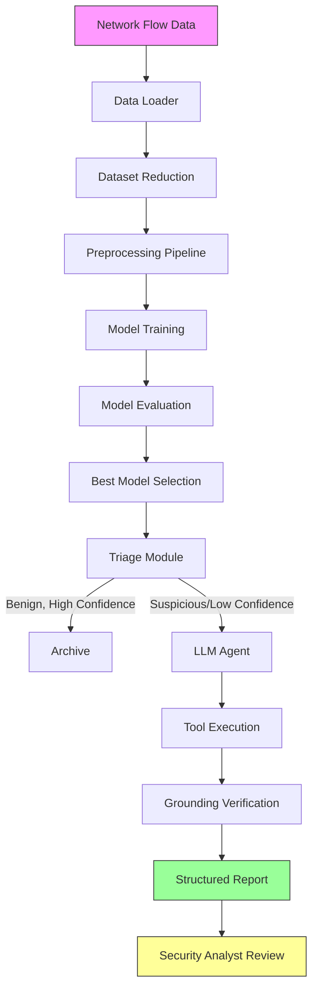

# Product Requirements Document: CyberAgent

## Problem Statement
Network security analysts face overwhelming volumes of network traffic data, making it difficult to promptly identify and investigate malicious activities. Traditional signature-based detection systems struggle with zero-day attacks and novel attack patterns. Machine learning approaches can detect anomalies but lack the explanatory power needed for effective investigation and response.

## Users
- **SOC Analysts**: Need to quickly triage alerts, investigate potential threats, and determine appropriate response actions.
- **Network Administrators**: Require visibility into network traffic patterns and automated detection of policy violations.
- **Security Engineers**: Want to understand attack patterns and improve defensive measures based on investigation findings.

## Goals
1. **Accurate Detection**: Use machine learning to classify network flows as benign or malicious with high accuracy.
2. **Explainable Investigations**: Employ LLM agents to investigate flagged flows and generate evidence-based reports.
3. **Grounded Reasoning**: Ensure LLM investigations are grounded in actual tool outputs and do not hallucinate.
4. **Actionable Outputs**: Provide structured reports with MITRE ATT&CK mappings and recommended actions.
5. **Human-in-the-Loop**: Flag uncertain cases for human review when evidence conflicts or confidence is low.

## Non-Goals
- Real-time packet processing (focus on flow-based analysis)
- Network intrusion prevention (detection and investigation only)
- Replacement of human analysts (augmentation tool)
- Deployment in production environments without further validation

## Success Metrics
- **Detection Performance**: Macro-F1 score ≥ 0.8 on test set
- **Benign False Positive Rate**: ≤ 0.05
- **Agent Groundedness**: ≥ 90% of agent claims verified by tool outputs
- **Schema Validity**: ≥ 95% of agent reports conform to expected structure
- **Verdict Agreement**: Agent verdicts align with true labels in ≥ 85% of cases
- **Tool Usage Efficiency**: Average ≤ 4 tool calls per investigation

## Architecture Overview

## Components
1. **Data Loader**: Reads and normalizes CIC-IDS2017 dataset
2. **Dataset Reduction**: Creates manageable dataset while preserving rare classes
3. **Preprocessing Pipeline**: Handles missing values, scaling, feature selection (train-only fitting)
4. **Model Zoo**: Trains multiple models (LR, RF, XGBoost, LightGBM, MLP) with MLflow tracking
5. **Triage Module**: Flags flows for agent investigation based on predictions and confidence
6. **LLM Agent**: Uses tool use to investigate flows and generate reports
7. **Grounding Verifier**: Validates that agent claims are supported by tool outputs
8. **API Layer**: Provides REST endpoints for frontend integration
9. **Frontend**: React dashboard for alert visualization and investigation viewing

## Risks and Mitigations
1. **Dataset Bias**: CIC-IDS2017 has known labeling issues
   - Mitigation: Document limitations, use synthetic data for testing, plan for corrected datasets
   
2. **Concept Drift**: Attack patterns evolve over time
   - Mitigation: Include anomaly detection for unknown attacks, periodic retraining
   
3. **LLM Hallucination**: Agent may generate unsupported claims
   - Mitigation: Grounding verifier, tool usage limits, fallback to template reports
   
4. **Scalability**: Processing large volumes of network flows
   - Mitigation: Batch processing, efficient feature extraction, model optimization
   
5. **Explainability Trade-offs**: Complex models may be less interpretable
   - Mitigation: SHAP explanations, feature importance analysis, focus on tree-based models

## Assumptions
- Dataset is available in the specified format under data/raw/
- Timestamps without AM/PM markers follow 8:00-17:00 working hours pattern
- Benign class can be safely downsampled for training without affecting detection of rare attacks
- MITRE ATT&CK mappings are available for attack classes present in the dataset
- LLM backend (Anthropic/Ollama/mock) is accessible as configured
